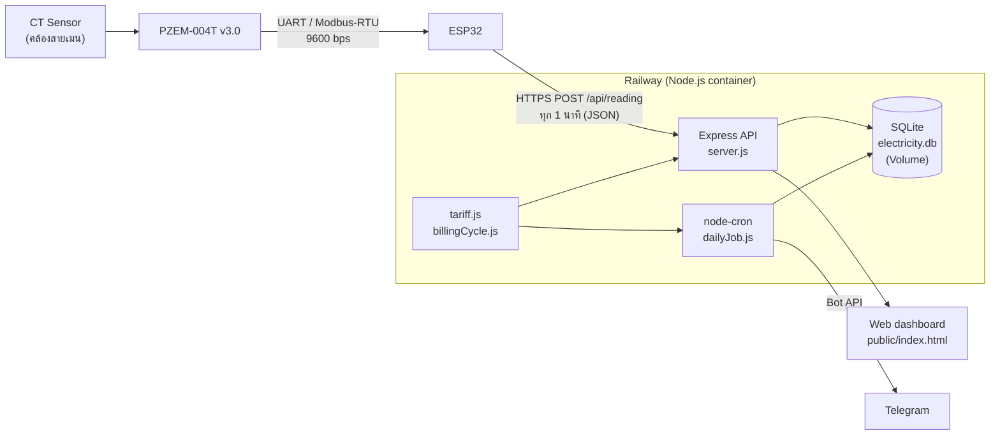

# ⚡ Home Energy Monitor — ESP32 + PZEM-004T + Telegram

ระบบตรวจวัดไฟฟ้าในบ้านด้วย IoT แสดงผลบนเว็บแดชบอร์ด คำนวณค่าไฟตาม **อัตราก้าวหน้าของ กฟภ. (ไทย)** จากหน่วยสะสมของรอบบิล และส่งสรุปประจำวันเข้า **Telegram** ทุกวัน พร้อมเทียบกับงบที่ตั้งไว้

> **English summary:** An IoT home electricity monitor. An ESP32 reads voltage / current / power / energy / frequency / power factor from a PZEM-004T + split-core CT every minute and POSTs it over HTTPS to a Node.js + SQLite backend (deployable on Railway). The backend computes the bill using Thailand's progressive residential tariff (PEA type 1.1.1 / 1.1.2, adjustable Ft, billing cycle 26th→25th, VAT 7%), serves a web dashboard, and sends a daily Telegram summary against a user-defined budget. Built as a senior project in Electrical (Power) Engineering, Prince of Songkla University, Hat Yai. **This is a student prototype — see [Limitations](#ข้อจำกัดที่ทราบ-และไอเดียสำหรับคนที่จะทำต่อ) before using it for anything serious.**

<!-- ใส่ภาพหน้าจอตรงนี้ เช่น docs/images/dashboard.png, docs/images/telegram.png -->

---

## สารบัญ
- [ทำอะไรได้บ้าง](#ทำอะไรได้บ้าง)
- [สถาปัตยกรรม](#สถาปัตยกรรม)
- [โครงสร้างโฟลเดอร์](#โครงสร้างโฟลเดอร์)
- [อุปกรณ์ที่ใช้](#อุปกรณ์ที่ใช้)
- [เริ่มใช้งาน](#เริ่มใช้งาน)
- [Environment variables](#environment-variables)
- [REST API](#rest-api)
- [วิธีคิดค่าไฟ](#วิธีคิดค่าไฟ)
- [ผลที่ได้จากการเก็บข้อมูลจริง](#ผลที่ได้จากการเก็บข้อมูลจริง)
- [ข้อจำกัดที่ทราบ และไอเดียสำหรับคนที่จะทำต่อ](#ข้อจำกัดที่ทราบ-และไอเดียสำหรับคนที่จะทำต่อ)
- [ความปลอดภัย](#ความปลอดภัย)
- [ผู้จัดทำและอ้างอิง](#ผู้จัดทำและอ้างอิง)

## ทำอะไรได้บ้าง

| ส่วน | ความสามารถ |
|---|---|
| **ฮาร์ดแวร์** | วัดแรงดัน (V) กระแส (A) กำลัง (W) ตัวประกอบกำลัง (PF) ความถี่ (Hz) และพลังงานสะสม (kWh) ส่งขึ้นเซิร์ฟเวอร์ทุก 1 นาที มี Watchdog และรีสตาร์ทเมื่อ Wi-Fi หลุดเกิน 5 นาที |
| **Backend** | Express REST API + SQLite รวมข้อมูลเป็นช่วง 15 นาที สรุปรายวันด้วย cron คำนวณค่าไฟรายวัน/รายรอบบิล |
| **แดชบอร์ด** | กำลังไฟฟ้าปัจจุบัน สรุปรายวัน แนวโน้ม 7/30 วัน กราฟสะสมแบบขั้นบันได เปรียบเทียบเดือน (MoM/YoY เมื่อมีข้อมูลพอ) และเมนูตั้งค่า Ft / งบ / ประเภทอัตราค่าไฟ |
| **Telegram** | ส่งสรุปประจำวัน: ยอดใช้ไปแล้ว งบ คงเหลือ หน่วยและค่าไฟของวัน เทียบค่าเฉลี่ย 7 วัน และเตือนเมื่อเกินงบ |

## สถาปัตยกรรม



## โครงสร้างโฟลเดอร์

```
.
├── esp32_send_data_railway/    # firmware ESP32 (Arduino IDE) — เปิดไฟล์ .ino
├── public/                     # เว็บแดชบอร์ด (HTML/CSS/JS + Chart.js แบบ local)
│   ├── index.html
│   ├── assets/
│   └── vendor/chart.umd.js
├── server.js                   # Express app + REST API
├── db.js                       # สร้างตาราง SQLite (readings, daily_summary, settings)
├── tariff.js                   # อัตราค่าไฟ กฟภ. + ฟังก์ชันคำนวณ
├── billingCycle.js             # คำนวณรอบบิล (26 → 25) แก้วันตัดรอบได้ที่นี่
├── dailyJob.js                 # cron สรุปรายวัน + ส่ง Telegram
├── telegram.js                 # ตัวส่งข้อความผ่าน Bot API
├── package.json
└── .gitignore
```

## อุปกรณ์ที่ใช้

- ESP32 DevKit (3.3 V logic)
- PZEM-004T **v3.0** + CT แบบคล้อง (split-core, ตัวอย่างใช้ 100 A)
- แหล่งจ่ายไฟ 5 V สำหรับ ESP32
- เครือข่าย Wi-Fi 2.4 GHz ที่บ้าน

การต่อสาย (ตามโค้ด `PZEM004Tv30 pzem(Serial2, 16, 17)`):

| ESP32 | PZEM-004T |
|---|---|
| GPIO16 (RX2) | TX |
| GPIO17 (TX2) | RX |
| 5 V (VIN) | 5 V |
| GND | GND |

> ⚠️ **PZEM-004T ต่อกับไฟบ้าน 220 V** ฝั่ง AC ต้องติดตั้งโดยผู้มีความรู้ ตัดไฟที่เบรกเกอร์ก่อนทุกครั้ง และใส่กล่องหุ้มฉนวน ห้ามจับอุปกรณ์ขณะมีไฟ ผู้จัดทำไม่รับผิดชอบความเสียหายใด ๆ จากการนำไปติดตั้ง

## เริ่มใช้งาน

### 1) สร้าง Telegram Bot
1. คุยกับ [@BotFather](https://t.me/BotFather) → `/newbot` → จะได้ **Bot Token**
2. ส่งข้อความหาบอทของคุณ 1 ข้อความ แล้วเปิด `https://api.telegram.org/bot<TOKEN>/getUpdates` เพื่อดู `chat.id` ของคุณ → นี่คือ **Chat ID**

### 2) รัน backend ในเครื่อง
```bash
npm install
export TELEGRAM_BOT_TOKEN="<token>"
export TELEGRAM_CHAT_ID="<chat id>"
npm start            # หรือ npm run dev
# เปิด http://localhost:3000
```
ถ้าไม่ตั้ง Telegram ไว้ ระบบยังรับข้อมูลและแสดงแดชบอร์ดได้ แต่จะส่งข้อความไม่สำเร็จ (ดู log)

ทดสอบโดยไม่ต้องมีฮาร์ดแวร์:
```bash
curl -X POST http://localhost:3000/api/reading \
  -H "Content-Type: application/json" \
  -d '{"voltage":229.8,"current":2.834,"power":581.9,"energy":146.276,"frequency":50.0,"power_factor":0.89}'
```

### 3) Deploy บน Railway
1. Push โค้ดขึ้น GitHub แล้วสร้าง Project ใน [Railway](https://railway.app) แบบ *Deploy from GitHub repo* (push ครั้งต่อไปจะ build/deploy อัตโนมัติ)
2. ใส่ Variables: `TELEGRAM_BOT_TOKEN`, `TELEGRAM_CHAT_ID`
3. **แนบ Volume** ให้บริการ (Railway จะตั้ง `RAILWAY_VOLUME_MOUNT_PATH` ให้เอง) — ถ้าไม่แนบ ฐานข้อมูลจะหายทุกครั้งที่ deploy ใหม่
4. สร้าง Public Domain แล้วจดโดเมนไว้ใส่ในขั้นตอนถัดไป

### 4) อัปโหลดโปรแกรมลง ESP32
1. ติดตั้ง Arduino IDE + ESP32 board package และไลบรารี **PZEM004Tv30**
2. เปิด `esp32_send_data_railway/esp32_send_data_railway.ino` แล้วแก้ 3 ค่า:
   ```cpp
   const char* WIFI_SSID     = "YOUR_WIFI_SSID";
   const char* WIFI_PASSWORD = "YOUR_WIFI_PASSWORD";
   const char* SERVER_HOST   = "your-app.up.railway.app"; // ไม่ต้องมี https://
   ```
3. อัปโหลด แล้วเปิด Serial Monitor ดูว่าขึ้น "ส่งข้อมูลสำเร็จ"

### 5) ตั้งค่าในแดชบอร์ด
เปิดเมนูตั้งค่าเพื่อกรอก **ค่า Ft** (ตามประกาศ กกพ. ล่าสุด) **ประเภทอัตราค่าไฟ** (ดูเลข 3 ตัวแรกของช่อง "ประเภท" บนบิล: `111` = 1.1.1, `112` = 1.1.2) และ **งบประมาณรายเดือน**

## Environment variables

| ชื่อ | จำเป็น | คำอธิบาย |
|---|---|---|
| `TELEGRAM_BOT_TOKEN` | สำหรับแจ้งเตือน | token จาก @BotFather |
| `TELEGRAM_CHAT_ID` | สำหรับแจ้งเตือน | แชตที่จะรับข้อความ |
| `PORT` | ไม่ | Railway ตั้งให้อัตโนมัติ (ค่าเริ่มต้น 3000) |
| `RAILWAY_VOLUME_MOUNT_PATH` | ไม่ | Railway ตั้งให้เมื่อแนบ Volume — ใช้เป็นที่เก็บ `electricity.db` |

## REST API

| Method | Endpoint | หน้าที่ |
|---|---|---|
| POST | `/api/reading` | รับข้อมูลจาก ESP32 (ต้องมีอย่างน้อย `power` และ `energy`) |
| GET | `/api/readings/latest` | ค่าล่าสุด |
| GET | `/api/readings/today`, `/api/readings/today-15min` | ข้อมูลของวันนี้ (ดิบ / รวมช่วง 15 นาที) |
| GET | `/api/summary/daily?days=N` | สรุปรายวันย้อนหลัง N วัน |
| GET | `/api/summary/today`, `/monthly`, `/month` | สรุปวันนี้ / รายเดือน |
| GET | `/api/summary/cycle` | ยอดสะสมรอบบิลปัจจุบัน (26 → 25) |
| GET | `/api/summary/compare-mom`, `/compare-yoy` | เทียบเดือนก่อน / ปีก่อน (ต้องมีข้อมูลพอ) |
| GET / POST | `/api/settings/ft-rate` | ค่า Ft |
| GET / POST | `/api/settings/tariff-type` | `1.1.1` หรือ `1.1.2` |
| GET / POST | `/api/settings/budget` | งบประมาณ |
| GET | `/api/health` | ตรวจว่าเซิร์ฟเวอร์ทำงาน |

## วิธีคิดค่าไฟ

อ้างอิงอัตราของ กฟภ. (มีผลตั้งแต่ พ.ค. 2566) ดู `tariff.js`

| ประเภท | ขั้นอัตรา (บาท/หน่วย) | ค่าบริการ/เดือน |
|---|---|---|
| **1.1.2** (ค่าเริ่มต้น) | 1–150: 3.2484 · 151–400: 4.2218 · >400: 4.4217 | 24.62 |
| **1.1.1** | 0–15: 2.3488 · 16–25: 2.9882 · 26–35: 3.2405 · 36–100: 3.6237 · 101–150: 3.7171 · 151–400: 4.2218 · >400: 4.4217 | 8.19 |

- **ค่า Ft** ค่าเริ่มต้น 0.1623 บาท/หน่วย (ปรับได้ในแดชบอร์ด เพราะประกาศใหม่ทุก 4 เดือน)
- **VAT 7 %** คิดจาก (ค่าไฟฐาน + Ft + ค่าบริการ)
- **รอบบิล** เริ่มวันที่ 26 ของเดือนก่อน ถึงวันที่ 25 ของเดือนนี้ (แก้ `METER_READING_DAY` ใน `billingCycle.js` ถ้ามิเตอร์ของคุณจดคนละวัน)
- **ค่าไฟรายวัน** = ค่าไฟสะสมสิ้นวัน − ค่าไฟสะสมสิ้นวันก่อนหน้า โดยหาจาก *หน่วยสะสมของรอบบิล* (ไม่ใช่หน่วยของวันนั้นเดี่ยว ๆ) เพื่อให้ผลรวมรายวันเท่ากับการคิดทั้งรอบบิล ค่าบริการบวกครั้งเดียวต่อรอบ

> ยอดที่ระบบคำนวณเป็น **ค่าประมาณเพื่อติดตามการใช้งาน** ยังไม่ได้ตรวจสอบเทียบกับใบแจ้งหนี้จริง

## ผลที่ได้จากการเก็บข้อมูลจริง

บ้านกรณีศึกษา 1 หลัง เก็บข้อมูล 26 ก.ย. – 7 ต.ค. 2569 (12 วัน, มีข้อมูลสรุป 11 วัน เพราะขาดวันที่ 29 ก.ย. ซึ่งยังไม่ทราบสาเหตุ):

| ตัวชี้วัด | ค่า |
|---|---|
| หน่วยไฟฟ้าสะสม (11 วัน) | 135.916 kWh |
| เฉลี่ย / สูงสุด / ต่ำสุดต่อวัน | 12.36 / 15.551 (28 ก.ย.) / 9.349 (2 ต.ค.) kWh |
| ค่าไฟรายวัน เฉลี่ย / สูงสุด / ต่ำสุด | 45.09 / 56.75 / 34.12 บาท |
| ผลรวมค่าไฟรายวัน | 496.02 บาท |
| รวมค่าบริการ + VAT (ยอดชั่วคราว) | 522.36 บาท |
| ข้อความ Telegram ที่ส่งได้ | 11 / 11 วันที่มีข้อมูลสรุป |

หน่วยสะสมยังไม่ถึง 150 หน่วย ทุกวันจึงคิดด้วยอัตราขั้นที่ 1 — **ผลของการคิดข้ามขั้นยังไม่ถูกทดสอบกับข้อมูลจริง**

## ข้อจำกัดที่ทราบ และไอเดียสำหรับคนที่จะทำต่อ

**ยังไม่ได้ทำ / ควรปรับก่อนใช้จริง**

1. **ยังไม่เทียบกับใบแจ้งหนี้** — เก็บข้อมูล 3–4 รอบบิล แล้ววิเคราะห์ความคลาดเคลื่อน (%) โดยเฉพาะช่วงที่ข้ามขั้น 150 / 400 หน่วย
2. **ยังไม่ได้ calibrate เซนเซอร์** — ความแม่นยำอ้างตามสเปคผู้ผลิต (±0.5 %) ลองเทียบกับมิเตอร์/เครื่องมือมาตรฐาน
3. **ไม่มี buffer บน ESP32** — ถ้า Wi-Fi หรือเซิร์ฟเวอร์ล่ม รอบที่ส่งไม่สำเร็จจะถูกข้าม ข้อมูลช่วงนั้นหาย (ไอเดีย: เก็บลง SPIFFS/LittleFS หรือการ์ด SD แล้วส่งย้อนหลัง)
4. **ไม่มีการแจ้งเตือนเมื่อข้อมูลขาด** — ตอนนี้รู้ได้เองจากการที่ไม่มีข้อความ Telegram (ไอเดีย: heartbeat / แจ้งเมื่อไม่มีข้อมูลเกิน N นาที)
5. **ไม่มีแจ้งเตือนระหว่างวัน** — ส่งเฉพาะสรุปรายวัน (ไอเดีย: เตือนเมื่อค่าไฟสะสมถึง 80 % / 100 % ของงบ หรือเมื่อกำลังไฟสูงผิดปกติ)
6. **Timezone** — เวลาที่บันทึกและการแบ่ง "วัน" ในโค้ดใช้ UTC (`toISOString`) และ cron `5 0 * * *` ทำงานตามเวลาเซิร์ฟเวอร์ (UTC บน Railway = 07:05 น. เวลาไทย) ควรตรวจสอบและทำให้อิง `Asia/Bangkok` ให้ชัดเจน
7. **ทดสอบอัตโนมัติ** — ยังไม่มี unit test ของ `tariff.js` / `billingCycle.js` (เหมาะเป็นงานแรกสำหรับผู้เริ่มต้น)

**ไอเดียต่อยอด**

- รองรับ **หลายบ้าน / หลายผู้ใช้** (ตอนนี้ 1 อุปกรณ์ ต่อ 1 ฐานข้อมูล)
- วิเคราะห์ **รายอุปกรณ์ / รายวงจร** (หลาย CT หรือ NILM เพื่อบอกว่าเครื่องไหนกินไฟมากสุด)
- **พยากรณ์ยอดสิ้นรอบบิล** จากแนวโน้มการใช้ แล้วเตือนล่วงหน้าว่าจะข้ามขั้นอัตรา
- ปุ่ม **ส่งออก CSV**, รองรับ **TOU/TOD** (อัตราตามช่วงเวลา) และบ้านประเภทอื่น
- เปลี่ยนไปใช้ **MQTT** หรือเชื่อมต่อ Home Assistant / Grafana
- ย้ายฐานข้อมูลไป PostgreSQL ถ้าต้องการหลายผู้ใช้หรือเก็บข้อมูลระยะยาว

## ความปลอดภัย

โค้ดนี้เป็นต้นแบบเพื่อการเรียน **ยังไม่เหมาะกับการเปิดสู่สาธารณะ**

- API **ไม่มีการยืนยันตัวตน** และเปิด CORS ทั้งหมด — ใครรู้ URL ก็อ่านข้อมูลการใช้ไฟและเปลี่ยนค่าตั้งได้ (ข้อมูลการใช้ไฟบอกได้ว่าเมื่อไรบ้านไม่มีคน) อย่าโพสต์ URL ที่ deploy จริงในที่สาธารณะ
- ESP32 ใช้ `client.setInsecure()` คือ **ไม่ตรวจใบรับรอง TLS** (ไอเดีย: ใส่ root CA ของเซิร์ฟเวอร์ และเพิ่ม API key / token ในส่วนหัวของคำขอ)
- **อย่า commit ความลับ**: รหัส Wi-Fi, Telegram bot token, ไฟล์ `electricity.db` (เป็นข้อมูลส่วนตัว) — โปรเจคนี้ใช้ environment variable สำหรับ Telegram และมี `.gitignore` กันไฟล์ฐานข้อมูลกับ `node_modules`

## ผู้จัดทำและอ้างอิง

โครงงานวิศวกรรมไฟฟ้ากำลัง (รายวิชา 212-401) คณะวิศวกรรมศาสตร์ มหาวิทยาลัยสงขลานครินทร์ วิทยาเขตหาดใหญ่
ผู้จัดทำ: อันศอร จินารง · อามีรูซ อิแม — อาจารย์ที่ปรึกษา: ผศ. อนุวัตร ประเสริฐสิทธิ์

อัตราค่าไฟ: การไฟฟ้าส่วนภูมิภาค, [อัตราค่าไฟฟ้า (มีผลตั้งแต่พฤษภาคม 2566)](https://www.pea.co.th/sites/default/files/documents/tariff/Electricity_Tariff_MAY_2023.pdf)

## License

<!-- เลือกให้ชัดก่อนเผยแพร่ เช่น MIT: เพิ่มไฟล์ LICENSE แล้วเปลี่ยนบรรทัดนี้เป็น "MIT — ดูไฟล์ LICENSE" -->
ยังไม่ได้ระบุ (ถ้าไม่ใส่ไฟล์ LICENSE คนอื่นจะมีสิทธิ์ใช้ซ้ำโดยกฎหมายได้จำกัด หากต้องการให้คนนำไปต่อยอดได้เต็มที่ แนะนำ MIT)
